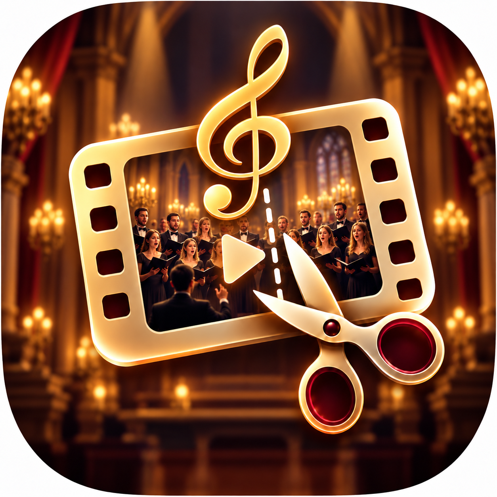
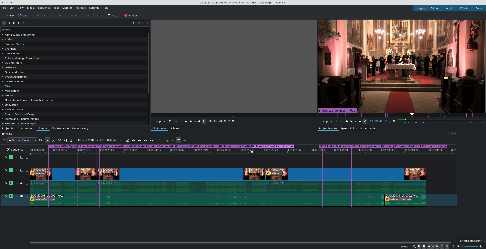
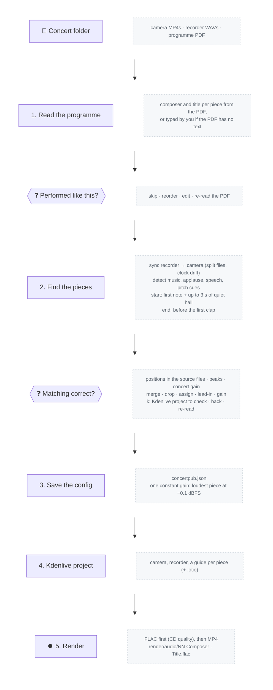

<p align="center"></p>

<h1 align="center">Concert Pub</h1>

Turns the recording of a concert — camera video, a separate field recorder (e.g. a Zoom
H6) and the printed programme — into one publishable file per piece:

```
render/audio/01 Uršula Jašovec - Grajska gospa in berač.flac
render/video/01 Uršula Jašovec - Grajska gospa in berač.mp4
...
```

plus a Kdenlive project to review or fine-tune the result. Mainly built for classical
concerts: applause and spoken narration between pieces are left out, pieces are named
after the programme, and the whole concert gets one constant gain.



## Features

- **Sync** the recorder audio to the camera, also across split files (4 GB camera
  chunks, 2 GB WAV chunks) and with clock drift between the devices.
- **Find the pieces**: a pretrained audio classifier (PANNs, AudioSet) labels music,
  applause and speech; pieces start at the first note (after the pitch is given, with up
  to 3 s of quiet hall before it) and end where the audience starts to clap.
- **Name them** from the programme PDF (rule-based parser, no network) after you have
  confirmed which pieces were actually performed and how the recording matches them.
- **Raise the volume** of the whole concert by one constant amount — as much as possible
  without clipping in any piece. No fades, compression or other processing.
- **Remove a constant buzz** (optional): mains hum from an amplifier or speaker near the
  stage is detected in the quiet pauses; if found, the matching question warns about it and
  `h` removes it from the exports with narrow notch filters that follow the mains frequency
  as it drifts, leaving the music untouched.
- **Export** FLAC (recorder audio in CD quality — 44.1 kHz / 16-bit, dithered, maximum
  lossless compression; lower-quality recordings are kept as they are) and MP4 (camera
  video in its original resolution and frame rate, x264 CRF 22 — the quality of a Kdenlive
  render — with the recorder audio as
  AAC 320 kbps at 44.1 kHz), and a **Kdenlive** project (plus an OpenTimelineIO file).

## Requirements

- Linux (other platforms untested), Python 3.11+, [uv](https://docs.astral.sh/uv/)
- `ffmpeg` / `ffprobe`; optional `pdftotext` (poppler-utils) for better PDF text extraction
- No GPU needed: the detector runs on the CPU (about a minute for a 90-minute concert)

```bash
sudo apt install ffmpeg poppler-utils
git clone <this repository> && cd concertpub
uv sync            # installs a CPU-only build of PyTorch
```

The detector weights (PANNs CNN14, ~330 MB) are downloaded on first use to
`~/.cache/concertpub` (change with `--model-dir` or `$CONCERTPUB_MODEL_DIR`).

## Quickstart

Put the camera files, the recorder WAVs and the programme PDF of one concert in a folder,
then run:

```bash
uv run concertpub /path/to/concert
```

It asks you two questions and writes everything next to the media:
`concertpub.json` (what was found and confirmed), a Kdenlive project, and the pieces in
`render/audio/*.flac` and `render/video/*.mp4`.



Every step can also be run on its own (`analyze`, `kdenlive`, `render`), and every
command has options — see:

```bash
uv run concertpub --help
uv run concertpub analyze --help
```

### Metadata

The tags written to the files come from `concertpub.json`. To change them, edit the file
and run `concertpub` again — your values are kept on later runs:

```json
"concert": {
  "album": "Bolečina in lepota",
  "artist": "Komorni zbor De profundis Kranj",
  "date": "2026-10-16",
  "tags": {"genre": "Choral", "conductor": "Branka Potočnik Krajnik"}
}
```

`album` is read from the first line of the programme, `artist` from a line naming the
choir or ensemble, and `date` from the folder name (`20261016_…`). Anything under `tags` is
written as is. Composer and title are set per piece (`pieces[].composer`, `pieces[].title`).

### The Kdenlive project

Written for Kdenlive 26.04 (document version 1.1, works with 23.04+ in principle):

- V1: the camera files; A2: the camera sound (muted track); A1: the recorder files, whole
  and back to back at one sync offset, each with a volume filter at the concert gain
- guides `NN Composer - Title` at the start and `NN end` at the end of every piece, so
  Kdenlive's *render by guides* works as well
- the project profile (resolution, frame rate) is taken from the camera files

If a future Kdenlive version cannot open it, import the `.otio` file instead
(File → OpenTimelineIO Import): same clips and markers, without the volume filters.

## Credits and license

- Sound event detection: [PANNs](https://github.com/qiuqiangkong/audioset_tagging_cnn)
  (Kong et al., *PANNs: Large-Scale Pretrained Audio Neural Networks for Audio Pattern
  Recognition*, 2020) via `panns-inference`. The model weights are downloaded from
  [Zenodo](https://zenodo.org/record/3987831) and are licensed CC BY 4.0.
- Timeline export: [OpenTimelineIO](https://opentimelineio.readthedocs.io/).

Concert Cut was vibe coded by Matevž Jekovec. It is released under the
[MIT License](LICENSE).
